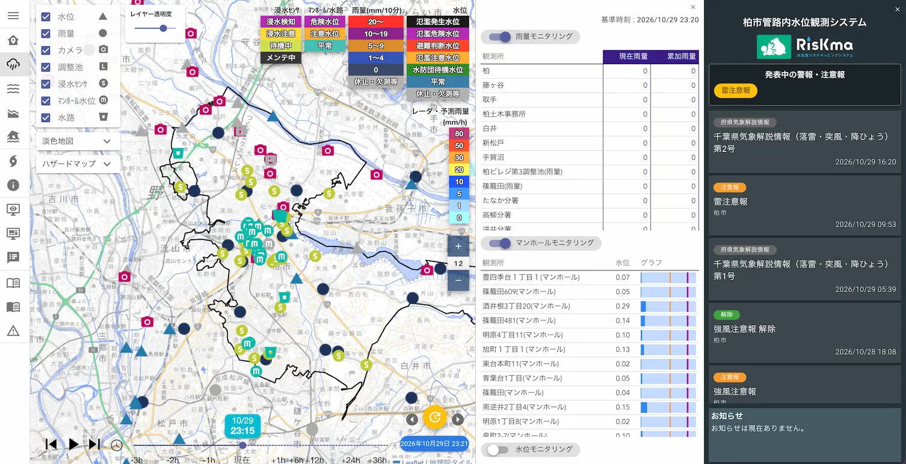
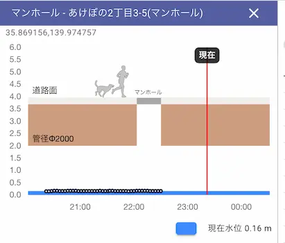
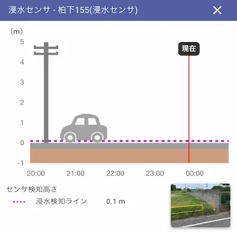
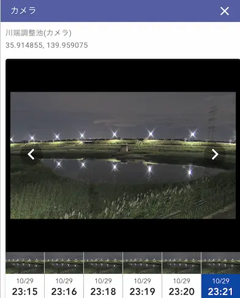

## はじめに：2026年8月千葉豪雨

2026年8月、千葉県の広い範囲で線状降水帯による豪雨災害が発生し、多くの道路冠水が起きました。いわゆる「**千葉豪雨**」です。この際、柏市では独自に運用している**管路内水位観測システム**が現況把握で活用されました。この記事では、このシステムの概要や導入における工夫などについて、担当課である柏市上下水道局さんにヒアリングした内容をもとに紹介します。

なお本記事は、当サイト管理人が取りまとめたもので、柏市の公式発表ではありません。システムの運用や今後の方針に関する説明は、取材時点のものです。

## 柏市管路内水位観測システムとは

「**柏市管路内水位観測システム**」はその名の通り、市内のマンホール下や貯水池、道路の水位をリアルタイムで監視するシステムです。市内各所のマンホールや道路に設置された各種センサーが水位を測定し、数分間隔で常にシステムに送信、それを誰もがウェブ上で見られるように公開しています。

ウェブサイト：[https://kashiwa.riskma.jp/](https://kashiwa.riskma.jp/#/)

大雨のニュースで近所の地名を聞いても、「具体的にどのあたりだろう」「家の周りや、いつも通る道はどうなっているのだろう」と、状況を思い浮かべにくいことがあります。建物の中にいると、外の様子がわからず不安を掻き立てられることも多いでしょう。そんなとき、地域の状況を知る手がかりになるのがこのシステムです。

## システムの特徴：実際に見てみよう

システムの画面には、水位、雨量、カメラ、調整池、浸水センサー、マンホール水位などの情報が表示されています。地図上で観測地点をクリックすると詳細な状況を確認できます。

*システムの全体画面。画面上の時刻は2026年10月29日23時20分のもの。*

### 最大の特徴：地下の水位を監視するマンホール内センサー

最大の特徴は、普段は見えない**地下の水位の状況をリアルタイムで確認できること**です。

マンホールの水位画面では、水位の推移とともに、道路面や管の位置関係が図で示されています。数字だけを読むよりも、「地下のどのあたりまで水があるのか」をイメージしやすい表示です。

*マンホール内の水位を示す画面。表示例の数値を、ほかの地点の危険度判断にそのまま当てはめることはできません。*

### もう一つの特徴：道路冠水を検知する地上のセンサー

地図には、道路上に設置された**浸水センサー**の情報もあります。これは地上、つまり**道路冠水**が起こったことを検知するセンサーであり、マンホール下の水位を測る機器とは全く別のものです。
主にこの2種類のセンサにより、地下と地上のそれぞれ異なる情報を、同じ地図で一元化して確認できるようになっています。

### 最新の技術を駆使：夜間でもくっきり鮮明なAIカメラ

さらに、市内の調整池などに取り付けられたカメラ画像から、その観測地点の現在の様子を見ることができます。このカメラ、実はAI技術などを駆使したハイテクなもので、担当者によると導入時から**夜間の見えやすさ**にも気を配ったり、人が映り込んだ時は自動的に**モザイク処理をかけるプライバシーに配慮した機能**が備わっているそうです。

「市内のカメラ映像はあっても夜間は真っ暗で何も見えない」となったら困ってしまいますが、このシステムで実際にカメラ映像を見てみてください。下図のように夜間でもくっきりと水位まで目視できます。

*川端調整池のカメラ画面。キャプチャの例では、夜間の様子も確認できます。天候や撮影条件によって見え方は異なります。*

## 導入の経緯：現存する合流式水道管

担当者によると、導入の検討が始まったのは令和2年（2020年）の豪雨を受けてのこと。その後、令和5年（2023年）の豪雨被害を経て、住民への情報公開に本格的に取り組むようになったといいます。

出発点となったのは、下水管から水があふれることへの懸念でした。雨水と生活排水を同じ管で流す仕組みを「**合流式**」といいます。市内の一部の地域ではこの「合流式」の下水管が現存しており、それが溢れるリスクを可視化・対策することが急務となっていました。

根本的な対策としては「雨水管を新しいものに更新していく」というハード面の整備が不可欠ですが、地下に埋まっている管を入れ替えるには大変な時間と工期がかかります。そこで、まずは**短期間で効果が期待できるソフト面の対策**として、こうしたシステムの導入が推進されました。

そうした背景もあって、このシステムは導入当初から住民に見てもらうことを前提に開発されました。**住民が自分で状況を確認し避難などの判断ができるように操作性や画面構成がデザイン**されています。

一方で、**職員もほぼ同じ画面を日常業務や豪雨時の対応に活用**されているとのことでした。職員が日々使うことで、細かい改善点への気づきにも繋がっているようです。

## 予算の出処：下水道事業会計について

さて、市民目線でもう一つ気になる点が、システムの構築・運用に関わる予算および財源の話です。

担当者によると、取材時点では、柏市上下水道局の「**下水道事業会計**」の営業費用から支出しているとのことです。一般的に自治体システムは税金を原資とした予算をもとに運営されるイメージでしたが、水道局は下水道事業の収入や支出が存在するため、企業会計のような編成の中で取り組んでいる、という説明でした。ただし、今後のシステム拡張の計画次第では、庁内での予算要求や部署横断的な調整が必要になるかもしれません。

加えて、この取り組みには実証実験としての側面もあります。具体的には国土交通省の「**ワンコイン浸水センサ実証実験**」という枠組みの中で、センサーの設置・観測・公開を実際に行いながら、運用上の課題や使いやすさを確かめていく段階でもあるようです。

## システムを支える技術

ウェブサイトの画面をよくみると、水災害リスクマネジメントシステム「**RisKma**」の名称が表示されていることに気づきます。**RisKma**（りすくま）とは株式会社建設技術研究所が提供する水災害リスクマッピングシステムの登録商標であり、柏市の管路内水位観測システムはこのサービスを採用して実装されています。ただし導入にあたっては、複数の企業と相談しながら選定を行なったとのことです。

### 市が重視した技術仕様

担当者によると、導入の検討にあたっては**データを取得する間隔**や**カメラ画像へのモザイク処理**などの独自仕様を優先的に固めていったとのこと。利用者が目にする画面の背後には、こうした情報の取り方や見せ方について検討の積み重ねがあったようです。

また、地図表示の動作はLeafletという地図描画ライブラリ（プログラム）を活用して軽快な動作を実現しています。これは市の要望ではなくRisKma（事業者側）の仕様によるものとのことです。

### アクセス集中時の対策

柏市管路内水位観測システムは、その性質上、**豪雨発生時にアクセスが集中**します。その際に安定した情報配信を行うための仕組みとして、配信にはCDN（Content Delivery Network）を活用してアクセス集中に対応しています。

CDN自体は広く一般的に使われる技術ですが、これによってアクセスが自治体サーバなど特定の１箇所に集中することなく、世界中に分散したサーバから**安定的かつ高速にコンテンツ配信を行う**ことができます。

ただし、配信側の負荷対策と、利用する人のスマートフォンなどの通信環境は別のものです。お手元のスマートフォンやPC自体の通信環境が悪ければ、読み込みに時間がかかるケースも当然生じます。もしシステムがうまく表示されなければ、通信環境をご確認いただくのがよさそうです。

## 運用における課題と対策

運用を始めてからも、豪雨時の経験や防災担当部署からの要望を受け、表示の見やすさなどを頻繁に少しずつ改善しているそうです。2024年の運用開始以降、これまでに**機器の不具合**や、検知した情報が一部届かなかった事例なども課題として挙がりました。特に、センサ機器は消耗品であり、**定期的な更新**が必要となります。

### センサーの保守・更新

センサーの耐用年数については、電池寿命を約5年と見込み、それを踏まえて5年単位の契約や更新を検討しているとの説明がありました。

また、センサーは1日1回電波飛ばして状況を管理する仕組みになっており、センサーが故障したり通信できない状態になるとシステム上では黒マークで表示されます。これを職員が常に確認し、対応を行っているとのことです。

### センサーの設置場所の選定

センサーの設置場所は、過去の浸水被害などの経験や、管理する水路・調整池などを踏まえて検討しているとのこと。一方で、狭い道路などでは、機器を取り付ける場所がなかったり、新しく柱を立てると通行の妨げになったりして、設置が難しい場合もあるそうです。

さらに、市民からみたら同じ水施設であっても担当する部署や管轄が異なっていたりして、設置場所候補の情報把握・整備には制約や調整が多い様子でした。

### センサーの増設計画

市内のセンシングのカバー範囲も課題の一つであり、今後はセンサーの数を増やすことを検討中とのことです。
マンホール内の水位を測るセンサーと道路上に設置された浸水センサーは別物であり、費用面ではマンホール内水位センサーの方が高価となっています。どの機器をどこに設置するか、計画的に考えていくことが肝要となります。

### システムの知名度向上

システムの存在を住民に知ってもらうことも大きな課題となっています。「**広報かしわ**」など柏市の発信媒体で当該システムの紹介を行っていたり、こうした記事インタビューへの対応をしたり、そうした地道な活動は解決策の一つと言えます。一方で、広く一般の市民に認知されるためには、引き続き様々な取り組みが必要となるでしょう。

## 今後の展開

### 他の自治体への展開の可能性

この管路網水位観測システムの取り組みは、取材時点では他に同様の事例は見当たらず、柏市が先行しているユースケースと言えそうです。
そのため、柏市には他の自治体からも「同じような仕組みをつくりたい」「費用はどの程度かかるか」といった問い合わせが実際にあるそうです。

また、他市では類似した庁内システムを導入しても、一般には公開していないというケースもあるようです。当該システムは、センシングした情報を住民が地図上で確認できるようリアルタイムで一般公開していることが重要であり、こうしたシステムは「公開型GIS」と呼ばれます。その観点で、柏市の事例は公開型GISの実用例として他地域にも大いに参考になるでしょう。

### 過去データやオープンデータとしての提供について

システム上では過去のカメラデータも遡って確認できます。利用者からも、過去のデータを見たいという要望は寄せられていたそうです。
一方、取材時点では、CSVなど二次利用しやすい形式でオープンデータとして提供する予定はないとのお話でした。

## おわりに

普段は見えない地下の水位と、地上の様子を地図で知る。柏市管路内水位観測システムは、水害リスクを可視化することで、住民の避難判断を支援することや、必要以上に不安を煽らず安心感を提供するものとなっています。今後の活用にも引き続き注目しつつ、一人の市民として積極的に周知を図っていきたいと思いました。

## 出典

- 柏市上下水道局の担当者へのヒアリング（2026年9月15日に実施）
- 柏市管路内水位観測システム（[提供資料](https://kashiwa.riskma.jp/)）
- Riskma [公式サイト](https://www.riskma.net/ja/top)
- 国土交通省 [ワンコイン浸水センサ実証実験](https://www.mlit.go.jp/river/gijutsu/wankoinsensa/index.html)
